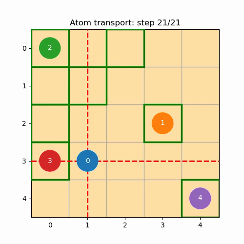

# SMT compiler

An SMT-based compiler for atom transport and CZ-layer scheduling on
reconfigurable neutral-atom arrays. The implementation is developed
independently using [Z3](https://github.com/Z3Prover/z3).

The current model combines AOD-controlled transport, fixed SLM trapping sites,
and a global Rydberg pulse. For each layer, it prioritizes the number of
simultaneous CZ gates, then the transport horizon needed to realize them.
Input interactions are unique, mutually commuting CZ pairs.

## Run

```sh
python3 -m pip install -r solver/requirements.txt
python3 solver/compiler.py
```

Generate an animation or export the schedule:

```sh
python3 solver/compiler.py --animate
python3 solver/compiler.py --json solver/output/schedule.json
```

MP4 export requires `ffmpeg`. Example parameters are defined in `main()` in
[`solver/compiler.py`](solver/compiler.py).

## Model and implementation

[`solver/README.md`](solver/README.md) describes the variables, constraints,
physical assumptions, and scheduling objective.

| File | Purpose |
| --- | --- |
| [`solver/compiler.py`](solver/compiler.py) | Layer selection, horizon search, and schedule construction |
| [`solver/constraints.py`](solver/constraints.py) | SMT constraint functions |
| [`solver/visualization.py`](solver/visualization.py) | Atom trajectories, AOD lines, and Rydberg-pulse visualization |
| [`solver/smt_introduction.py`](solver/smt_introduction.py) | Introductory Latin-square, graph-coloring, and maze examples |

## Demonstration

[](solver/media/scheduled_cz_layers.mp4)

Green outlines indicate SLM sites, dashed red lines indicate active AOD lines,
and the orange overlay indicates a global Rydberg pulse.

## Tests

```sh
python3 -m unittest discover -s solver -p "test_*.py"
```

## Repository branches

| Branch | Scope |
| --- | --- |
| `main` | SMT compiler and its mathematical model |
| [`manual_compilation`](https://github.com/Vladlen24/https---github.com-Vladlen24-neutral-atom-qec/tree/manual_compilation) | Hand-scheduled distance-3 surface-code logical state preparation |
| [`external_compilers`](https://github.com/Vladlen24/https---github.com-Vladlen24-neutral-atom-qec/tree/external_compilers) | Experiments with MQT QMAP, HyRoNA, and OLSQ-DPQA |
