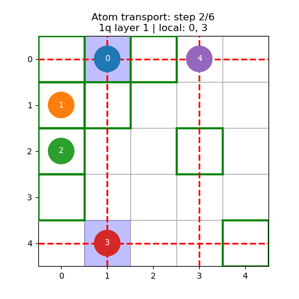

# SMT compiler

An SMT-based compiler for atom transport and gate-layer scheduling on
reconfigurable neutral-atom arrays. The implementation is developed
independently using [Z3](https://github.com/Z3Prover/z3).

The compiler schedules local and global single-qubit rotations with preserved operation order.
AOD rows and columns transport atoms between fixed SLM trapping sites.
For each layer, the search prioritizes the number of parallel gates, then
the transport horizon. Repeated gates retain separate operation IDs.

## Run

```sh
python3 -m pip install -r solver/requirements.txt
python3 solver/compiler.py
python3 solver/compiler.py --animate
python3 solver/compiler.py --json solver/output/schedule.json
```

MP4 export requires `ffmpeg`. `--animate` saves a video and PNG preview to
`solver/output/`; `--output-dir` selects another destination.
The example in `DEFAULT_GATES` uses local `rx(theta)` and `rz(theta)` rotations
and global `ry(theta)` rotations.

Programs can also be compiled directly:

```python
from solver.compiler import compile_schedule

schedule = compile_schedule([
    (0, ('rx', 1.5707963267948966)),
    ('global', ('ry', 1.5707963267948966)),
])
```

`DEFAULT_ARCHITECTURE` defines the grid, initial positions, SLM sites, AOD
line counts, and distance thresholds. Optional `architecture`, `layer_settings`,
and `use_constraints` dictionaries override individual settings in
`compile_schedule`. Gate angles are specified in radians.

## Model and implementation

[`solver/README.md`](solver/README.md) describes the formulas, physical
assumptions, and scheduling priority.

| File | Purpose |
| --- | --- |
| [`solver/compiler.py`](solver/compiler.py) | Candidate selection, horizon search, and schedule construction |
| [`solver/constraints.py`](solver/constraints.py) | Transport and gate-distance constraints |
| [`solver/visualization.py`](solver/visualization.py) | Atom paths, AOD lines, and gate-execution highlights |
| [`solver/smt_introduction.py`](solver/smt_introduction.py) | Introductory Latin-square, graph-coloring, and maze examples |

## Demonstration

[](solver/media/single_qubit_layers.mp4)

Green outlines indicate SLM sites; dashed red lines indicate active AOD lines.
Blue cells highlight atoms addressed by local rotations; a green field indicates
a global rotation.
Execution frames are separate from transport steps, so consecutive global
rotations remain visible without adding transport duration.

Compilation examples are collected in [`solver/media/`](solver/media/).

## Tests

```sh
python3 -m unittest discover -s solver -p "test_*.py"
```

## Repository branches

| Branch | Scope |
| --- | --- |
| `main` | SMT compiler and its mathematical model |
| [`1q_layer`](https://github.com/Vladlen24/neutral-atom-qec/tree/1q_layer) | Single-qubit scheduling |
| [`manual_compilation`](https://github.com/Vladlen24/neutral-atom-qec/tree/manual_compilation) | Hand-scheduled distance-3 surface-code logical state preparation |
| [`external_compilers`](https://github.com/Vladlen24/neutral-atom-qec/tree/external_compilers) | Experiments with MQT QMAP, HyRoNA, and OLSQ-DPQA |
