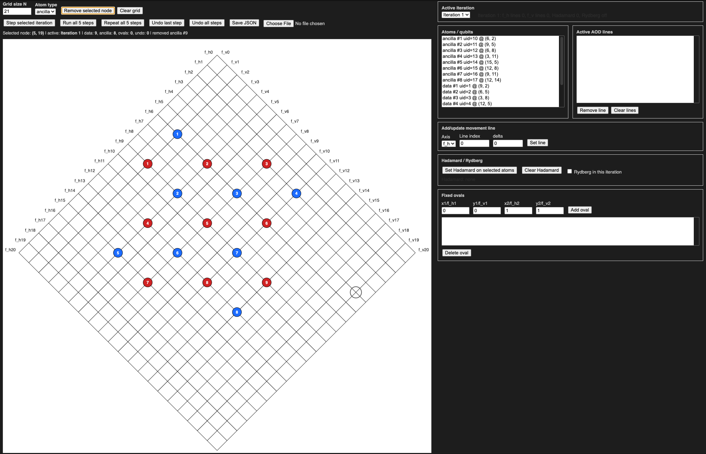

# Manual compilation

Hand-scheduled compilation of **distance-3 surface-code logical state
preparation** for a reconfigurable neutral-atom array.

[`main.ipynb`](main.ipynb) provides an interactive editor for atom placement,
AOD transport, and gate highlights. Its controls define a sequence of atom
movements, Hadamard operations, and Rydberg pulses. The demonstration uses
two families of diagonal AOD frequency lines.

## Run the example

Open `main.ipynb` in Jupyter with `IPython` installed and run its code cell.
Load [`atom_grid_config_v2.0_fix.json`](settings/atom_grid_config_v2.0_fix.json)
through the editor's JSON controls to inspect or modify the schedule.

## Demonstration

- [Current video](media/atom_configuration_v2.0_fix.mp4) and
  [configuration](settings/atom_grid_config_v2.0_fix.json).
- [Earlier video](media/atom_config_v2.0.mp4) and
  [configuration](settings/atom_grid_config_v2.0.json).

The repository's [main branch](https://github.com/Vladlen24/neutral-atom-qec)
contains the SMT compiler.
