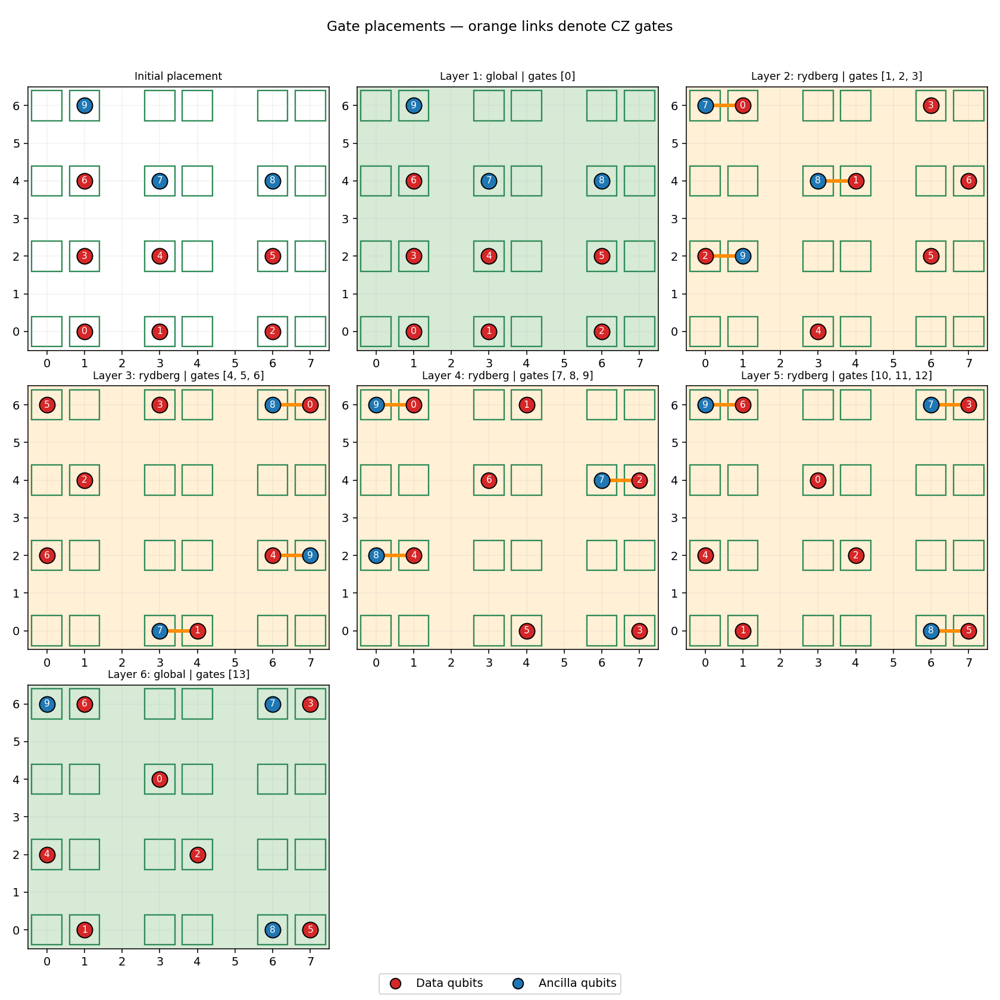
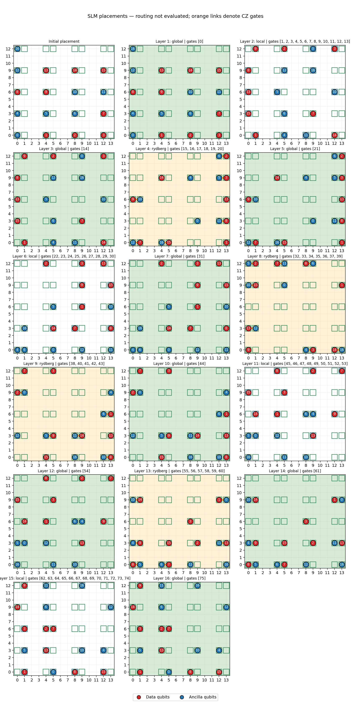

# SMT compiler: SLM placement

This branch, `placement-routing`, separates gate-layer placement from atom
routing. A Z3 solver assigns every atom to a distinct SLM trap at each gate
layer. Transport paths, AOD lines, switching states, and time horizons are
not represented in this model.

The compiler is developed independently using [Z3](https://github.com/Z3Prover/z3).
It schedules local rotations, global rotations, and CZ gates while preserving
operation order on each atom. Ready local rotations have priority over ready
CZ gates. Each layer prioritizes the number of parallel gates; optional sequential
A* routing checks whether its placement can be reached. A routing failure
reduces the layer size K. There is no movement-cost objective yet.

## Run

```sh
python3 -m pip install -r solver/requirements.txt
python3 solver/placement.py
python3 solver/placement.py --route --animate
python3 solver/placement.py --timeout-ms 60000
```

Results are written to `solver/output/placement/`. `--output-dir` selects another
folder. MP4 export requires `ffmpeg`. A timeout applies to each solver check;
UNKNOWN stops compilation and is not interpreted as UNSAT.

```python
from math import pi
from solver.placement import compile_placement, render_placement_snapshots

schedule = compile_placement([
    (0, ('rx', pi / 2)),
    (0, 1),
    ('global', ('ry', -pi / 2)),
])
render_placement_snapshots(schedule)
```

An optional `architecture` dictionary overrides fields of `DEFAULT_ARCHITECTURE`:
`width`, `height`, `slm_sites`, `starts`, `r_int`, `r_block`, and `r_crosstalk`.
Coordinates are integer grid positions; rotation angles are in radians.

## Model and output

[The placement model](solver/PLACEMENT_README.md) documents the constraints,
scheduling rules, and planned routing interface.

Each output layer contains its type, operation IDs and gates, and the position
of every atom. Repeated gates retain separate IDs. With `routing=True`, each accepted
placement includes a verified sequential route; placement-only results keep
`routing_verified` false.
Global rotations retain the preceding placement.

### Steane placement example

[](solver/media/Steane_placement.mp4)

The ten-atom example uses twelve CZ gates between data and ancilla atoms,
arranged into four Rydberg layers between two global rotations.

The videos include sequential AOD transport. Red dashed lines show the active
row and column, and purple outlines mark temporary SLM parking. PNG contact
sheets contain only initial and gate-execution placements, including any
smaller layers accepted after routing feedback.
Blue cells indicate local rotations, green shading indicates a global rotation,
and orange shading indicates a Rydberg pulse. Orange links denote CZ gates,
not transport paths. Frame duration does not represent physical execution time.

## Distance-3 surface-code example

[solver/surface_code_d3.py](solver/surface_code_d3.py) defines the 17-qubit
circuit with nine data qubits and eight ancillas. Its source is
`build_17_qubit_surface_code_circuit` in
[circuit.py on external_compilers](https://github.com/Vladlen24/neutral-atom-qec/blob/1c2fec30570c9060572d1015014b855dff14e2b1/circuit.py).
Hadamard layers are lowered to global RY and local RZ rotations. The input
contains 24 CZ gates, 44 local rotations, and eight global rotations.

```python
from solver.surface_code_d3 import ARCHITECTURE, ATOM_ROLES, build_gate_seq

schedule = compile_placement(build_gate_seq(), architecture=ARCHITECTURE, routing=True)
render_placement_snapshots(schedule, "solver/output/surface_code_d3", atom_roles=ATOM_ROLES)
```

[](solver/media/surface_code_d3_placements.mp4)

Data-qubit atoms are red; ancilla atoms are blue. The example uses 40 SLM
traps arranged in horizontal pairs and an arbitrary initial placement.
All 24 CZ gates fit into four Rydberg layers under the placement model.

## Implementation

| File | Purpose |
| --- | --- |
| [solver/placement.py](solver/placement.py) | SLM placement constraints, layer scheduling, and snapshot export |
| [solver/routing.py](solver/routing.py) | A* corridor paths, sequential transfers, cycle parking, and replay checks |
| [solver/test_placement.py](solver/test_placement.py) | Placement, ordering, cardinality, and failure checks |
| [solver/compiler.py](solver/compiler.py) | Earlier compiler with transport; shared operation indexing and candidate selection |
| [solver/README.md](solver/README.md) | Earlier transport model, retained for comparison |

```sh
python3 -m unittest discover -s solver -p 'test_*.py'
```

## Repository branches

| Branch | Scope |
| --- | --- |
| `placement-routing` | SLM placement and sequential A* routing |
| [main](https://github.com/Vladlen24/neutral-atom-qec/tree/main) | Compiler with joint transport and gate-layer search |
| [1q_layer](https://github.com/Vladlen24/neutral-atom-qec/tree/1q_layer) | Single-qubit scheduling |
| [manual_compilation](https://github.com/Vladlen24/neutral-atom-qec/tree/manual_compilation) | Hand-scheduled distance-3 surface-code logical state preparation |
| [external_compilers](https://github.com/Vladlen24/neutral-atom-qec/tree/external_compilers) | Experiments with external compilers |
